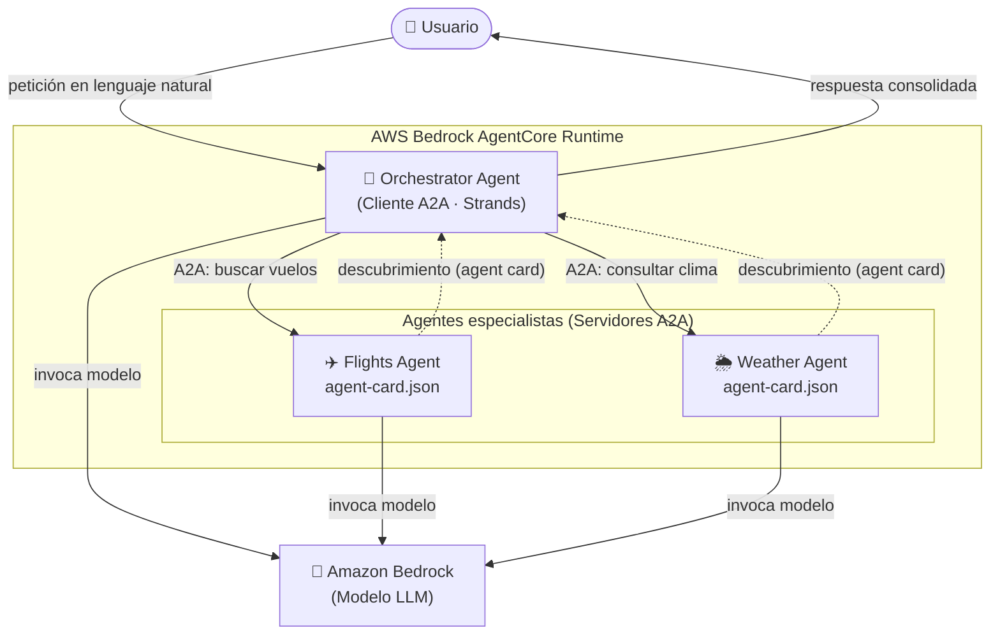
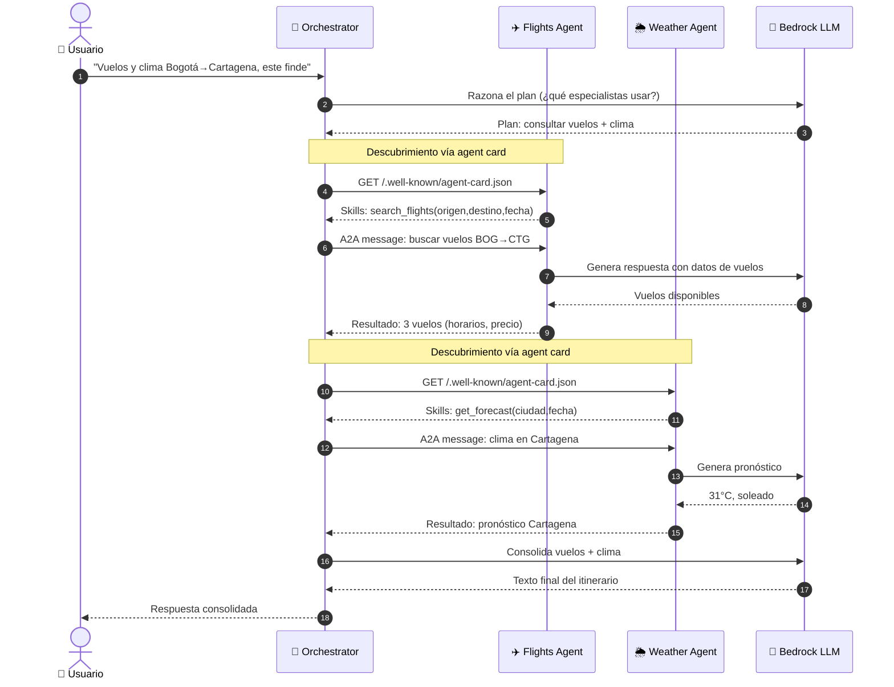

# TripPlanner AI · Trabajo Final (Programación Agéntica)

Plataforma web para planificar, organizar y gestionar viajes sobre una **arquitectura multiagente**
(Orchestrator + Flight Agent + Weather Agent en Amazon Bedrock AgentCore), un **backend serverless**
(API Gateway + Lambda + DynamoDB) y un **frontend React** publicado en S3 + CloudFront.

| | |
|---|---|
| 📐 Documentación técnica completa | [`tripplanner-web/docs/arquitectura.md`](tripplanner-web/docs/arquitectura.md) |
| 🚀 Despliegue desde cero | `.\deploy-all.ps1` (backend → agentes → frontend) |
| 🧪 Pruebas del backend | `tripplanner-web/backend/tests` (23 casos, moto) |
| 🎬 Guion de la demo (12 pasos) | [Sección 9 de la documentación](tripplanner-web/docs/arquitectura.md#9-escenario-de-demostración) |

```
tripplannera2a/
├── app/                     # Agentes Strands (OrchestratorAgent, FlightsAgent, WeatherAgent + MCP de clima)
├── agentcore/               # Configuración declarativa de AgentCore (runtimes, memoria, credenciales)
├── tripplanner-web/
│   ├── backend/             # AWS SAM: template.yaml, lambdas/, tests/
│   ├── frontend/            # React + Vite (Agent-Driven UI)
│   └── docs/                # Arquitectura, modelo de datos, APIs, Lambdas, Tools, integración
└── deploy-all.ps1           # Despliegue reproducible
```

---

> Lo que sigue es la documentación original del workshop A2A.

# 🌍 Trip Planner A2A Workshop

Sistema multi-agente que implementa el protocolo **Agent-to-Agent (A2A)** para planificación de viajes inteligente. Demuestra separación de responsabilidades, descubrimiento de agentes y colaboración mediante estándares abiertos.

## 📋 Tabla de Contenidos

- [El Problema](#-el-problema)
- [La Solución](#-la-solución)
- [Arquitectura](#-arquitectura)
- [Conceptos Clave A2A](#-conceptos-clave-a2a)
- [Prerrequisitos](#-prerrequisitos)
- [Estructura del Proyecto](#-estructura-del-proyecto)
- [Instalación](#-instalación)
- [Despliegue](#-despliegue)
- [Verificación y Pruebas](#-verificación-y-pruebas)
- [Retos Adicionales](#-retos-adicionales)

---

## 🎯 El Problema

Un usuario quiere planificar un viaje y hace una petición en lenguaje natural:

> "Quiero viajar de BOG a CTG el próximo fin de semana. ¿Qué vuelos hay y cómo estará el clima?"

Esta petición requiere **dos competencias distintas**:
- ✈️ Buscar vuelos disponibles
- 🌤️ Consultar el pronóstico del clima

## 💡 La Solución

En lugar de construir un único agente monolítico, aplicamos el principio de **separación de responsabilidades**: cada competencia vive en su propio agente independiente, y un tercer agente los coordina.

### Los Tres Agentes

#### 1. **Orchestrator Agent** (Cliente A2A)
- 🧭 Agente coordinador
- Recibe peticiones del usuario
- Decide qué especialistas consultar
- Invoca agentes remotos vía A2A
- Compone la respuesta final
- **Es el único con el que habla el usuario**

#### 2. **Flights Agent** (Servidor A2A)
- ✈️ Especialista en vuelos
- Expone la capacidad `search_flights(origin, destination, date)`
- Publica su **agent card** para descubrimiento
- Responde consultas sobre disponibilidad de vuelos

#### 3. **Weather Agent** (Servidor A2A)
- 🌦️ Especialista en clima
- Expone la capacidad `get_forecast(city, date)`
- Publica su **agent card** para descubrimiento
- Responde consultas sobre pronóstico del clima

---

## 🏗️ Arquitectura

### Diagrama de Contexto



### Diagrama de Secuencia



---

## 🔑 Conceptos Clave A2A

### ¿Qué es A2A?

**A2A (Agent-to-Agent)** es un protocolo estándar abierto que define cómo los agentes se descubren, comunican y colaboran entre sí.

### Elementos del Protocolo

#### 🎴 Agent Card
- Documento JSON publicado en `/.well-known/agent-card.json`
- Describe nombre, descripción y skills del agente
- Es la "tarjeta de presentación" para el descubrimiento
- Permite que otros agentes sepan qué capacidades ofrece

#### 🖥️ Servidor A2A
- Agente que expone sus capacidades por HTTP/JSON-RPC
- En Strands se crea con `A2AServer`
- Atiende peticiones en la raíz
- Publica automáticamente su agent card

#### 📡 Cliente A2A
- Agente (o app) que invoca a un servidor remoto
- En Strands se usa `A2AAgent(endpoint=...)`
- Se invoca como si fuera un agente local
- Lee la agent card del servidor para descubrimiento

#### 🔖 context_id
- Identifica cada conversación
- Aísla el estado de diferentes sesiones
- **Nota:** No es un límite de autenticación en este workshop

#### 📨 Task / Message
- Unidades del protocolo
- Cliente envía un mensaje
- Servidor responde con mensajes y actualizaciones de estado
- Soporta streaming de respuestas

### Ventajas del Patrón A2A

✅ **Desacoplamiento**: El orquestador nunca importa el código de los especialistas  
✅ **Descubrimiento**: Los agentes se encuentran mediante agent cards estándar  
✅ **Interoperabilidad**: Agentes en diferentes lenguajes pueden colaborar  
✅ **Escalabilidad**: Cada agente puede desplegarse y escalar independientemente  
✅ **Separación de responsabilidades**: Cada agente tiene una única competencia clara  

---

## ✅ Prerrequisitos

Antes de comenzar, asegúrate de tener:

- ✅ **Cuenta de AWS** con acceso a Amazon Bedrock
- ✅ **Modelos habilitados** en Bedrock (ej: `us.amazon.nova-lite-v1:0`)
- ✅ **Credenciales configuradas** localmente (`aws configure` o SSO)
- ✅ **agentcore CLI** instalada y funcionando
  ```powershell
  agentcore --help
  ```
- ✅ **Python 3.10+** instalado
- ✅ **uv** o **pip** para gestionar dependencias
  ```powershell
  python --version
  pip --version
  ```

### Instalación de agentcore CLI

Si no tienes `agentcore` instalado:

```powershell
# Seguir las instrucciones oficiales de AWS
# https://docs.aws.amazon.com/bedrock/latest/userguide/agentcore-cli.html
```

---

## 📁 Estructura del Proyecto

```
WORKSHOP A2A/
├── agentcore/
│   ├── agentcore.json          # Configuración de runtimes para AgentCore
│   └── aws-targets.json        # Configuración de despliegue AWS
├── requirements.txt            # Dependencias Python del proyecto
├── README.md                   # Este archivo
└── app/
    ├── FlightsAgent/
    │   └── main.py            # Servidor A2A - Búsqueda de vuelos
    ├── WeatherAgent/
    │   └── main.py            # Servidor A2A - Pronóstico del clima
    └── OrchestratorAgent/
        └── main.py            # Cliente A2A - Coordinador principal
```

### Descripción de Archivos Clave

#### `agentcore/agentcore.json`
Configura los tres runtimes:
- **FlightsAgent**: `protocol: "A2A"` - Servidor de vuelos
- **WeatherAgent**: `protocol: "A2A"` - Servidor de clima
- **OrchestratorAgent**: `protocol: "HTTP"` - Coordinador (usa envVars para URLs)

#### `agentcore/aws-targets.json`
Configura el destino de despliegue AWS (account, region, modelId)

#### `app/FlightsAgent/main.py`
- Define el tool `search_flights(origin, destination, date)`
- Crea un `A2AServer` que expone el agente
- Publica agent card en `/.well-known/agent-card.json`

#### `app/WeatherAgent/main.py`
- Define el tool `get_forecast(city, date)`
- Crea un `A2AServer` que expone el agente
- Publica agent card en `/.well-known/agent-card.json`

#### `app/OrchestratorAgent/main.py`
- Define tools `ask_flights()` y `ask_weather()`
- Usa `A2AAgent(endpoint=...)` para invocar especialistas
- Implementa el `@app.entrypoint` para AgentCore
- Consolida respuestas de ambos especialistas

---

## 🚀 Instalación

### 1. Clonar o navegar al proyecto

```powershell
cd "C:\Users\USUARIO\Desktop\WORKSHOP A2A"
```

### 2. Instalar dependencias

```powershell
# Con pip
pip install -r requirements.txt

# O con uv (recomendado)
uv pip install -r requirements.txt
```

### 3. Verificar instalación

```powershell
python -c "import strands; import bedrock_agentcore; print('✅ Dependencias instaladas correctamente')"
```

---

## 🌐 Despliegue

El despliegue se realiza en **tres fases**:

### Fase 1: Validar Configuración

Antes de desplegar, valida que `agentcore.json` sea correcto:

```powershell
agentcore validate
```

**Salida esperada:**
```
✅ Configuration is valid
```

### Fase 2: Prueba Local (Opcional pero Recomendado)

Levanta los agentes localmente con hot-reload para iterar rápido:

```powershell
agentcore dev
```

Esto inicia un servidor local donde puedes probar los agentes antes de desplegarlos a AWS.

### Fase 3: Despliegue a AWS

#### Paso 1: Desplegar los Especialistas Primero

```powershell
agentcore deploy
```

Este comando desplegará los tres agentes, pero **necesitamos las URLs de los especialistas** antes de que el orquestador funcione correctamente.

#### Paso 2: Obtener las URLs de los Especialistas

```powershell
agentcore status
```

**Salida esperada:**
```
Runtime: FlightsAgent
  Status: ACTIVE
  Endpoint: https://xxxxx.execute-api.us-east-1.amazonaws.com/
  
Runtime: WeatherAgent
  Status: ACTIVE
  Endpoint: https://yyyyy.execute-api.us-east-1.amazonaws.com/
  
Runtime: OrchestratorAgent
  Status: ACTIVE (sin URLs configuradas aún)
```

**Copia las URLs** de FlightsAgent y WeatherAgent.

#### Paso 3: Actualizar las Variables de Entorno

Edita `agentcore.json` y actualiza las `envVars` del OrchestratorAgent:

```json
{
  "name": "OrchestratorAgent",
  ...
  "envVars": [
    {
      "name": "FLIGHTS_AGENT_URL",
      "value": "https://xxxxx.execute-api.us-east-1.amazonaws.com/"
    },
    {
      "name": "WEATHER_AGENT_URL",
      "value": "https://yyyyy.execute-api.us-east-1.amazonaws.com/"
    }
  ]
}
```

#### Paso 4: Redesplegar el Orquestador

```powershell
agentcore deploy
```

Ahora el OrchestratorAgent tendrá las URLs correctas y podrá invocar a los especialistas.

---

## 🧪 Verificación y Pruebas

### 1. Invocar el Orquestador

```powershell
agentcore invoke --runtime OrchestratorAgent --payload '{\"prompt\": \"Quiero viajar de Bogotá a Cartagena este fin de semana. ¿Qué vuelos hay y cómo estará el clima?\"}'
```

**Respuesta esperada:**
```
📍 Viaje Bogotá → Cartagena

✈️ Vuelos disponibles:
- AV9821 (Avianca) - Salida: 07:15, Precio: $89 USD
- LA4410 (LATAM) - Salida: 12:40, Precio: $76 USD ⭐ Mejor precio
- AV9835 (Avianca) - Salida: 18:05, Precio: $102 USD

🌤️ Clima en Cartagena:
- Temperatura: 31°C (88°F)
- Condición: Soleado
- Día perfecto para la playa

💡 Recomendación: El vuelo de LATAM a las 12:40 ofrece el mejor precio...
```

### 2. Inspeccionar Agent Cards

Verifica que los especialistas publiquen sus capacidades:

```powershell
# FlightsAgent
curl https://xxxxx.execute-api.us-east-1.amazonaws.com/.well-known/agent-card.json

# WeatherAgent
curl https://yyyyy.execute-api.us-east-1.amazonaws.com/.well-known/agent-card.json
```

**Respuesta esperada (ejemplo FlightsAgent):**
```json
{
  "name": "Flights Agent",
  "description": "Agente especializado en buscar vuelos...",
  "skills": [
    {
      "name": "search_flights",
      "description": "Busca vuelos entre dos ciudades...",
      "parameters": { ... }
    }
  ]
}
```

### 3. Revisar Logs y Trazas

Para depurar la colaboración entre agentes:

```powershell
# Ver logs del orquestador
agentcore logs --runtime OrchestratorAgent

# Listar trazas de invocaciones
agentcore traces list
```

**Criterio de éxito:**
- ✅ El orquestador devuelve una respuesta consolidada
- ✅ En los logs se observan dos invocaciones A2A salientes
- ✅ Una invocación a FlightsAgent
- ✅ Una invocación a WeatherAgent
- ✅ Ambas respuestas se integran en el resultado final

### 4. Pruebas Adicionales

```powershell
# Solo vuelos
agentcore invoke --runtime OrchestratorAgent --payload '{\"prompt\": \"Busca vuelos de Bogotá a Medellín\"}'

# Solo clima
agentcore invoke --runtime OrchestratorAgent --payload '{\"prompt\": \"¿Cómo estará el clima en Cartagena mañana?\"}'

# Ambos
agentcore invoke --runtime OrchestratorAgent --payload '{\"prompt\": \"Planifica mi viaje a Medellín con vuelos y clima\"}'
```

---

## 🎓 Retos Adicionales

Una vez que el flujo base funcione, profundiza con estos desafíos:

### 1. 🏨 Tercer Especialista: HotelsAgent
- Crea un nuevo agente servidor A2A para buscar hoteles
- Expón un tool `search_hotels(city, check_in, check_out)`
- Actualiza el orquestador para consultarlo cuando sea necesario
- **Objetivo:** El LLM debe decidir automáticamente cuándo buscar hoteles

### 2. 🔄 Streaming End-to-End
- Modifica el orquestador para usar `stream_async` del `A2AAgent`
- Transmite tokens del especialista al usuario en tiempo real
- **Objetivo:** Ver la respuesta generándose progresivamente

### 3. 🕸️ Patrón Graph/Swarm
- Reemplaza las tools manuales por un patrón multi-agente de Strands
- Integra los `A2AAgent` remotos en un grafo de colaboración
- **Objetivo:** Colaboración más sofisticada entre agentes

### 4. 🛡️ Manejo de Fallos
- ¿Qué pasa si un especialista no responde?
- Agrega timeouts y respuestas degradadas
- Implementa retry logic con exponential backoff
- **Objetivo:** Sistema resiliente ante fallos

### 5. 🔐 Añadir Identity (Siguiente Workshop)
- Introduce `authorizerType: "CUSTOM_JWT"` en agentcore.json
- Implementa autenticación entre agentes
- Discute por qué `context_id` solo no basta
- **Objetivo:** Seguridad multi-tenant real

### 6. 🌍 Interoperabilidad Multi-Lenguaje
- Implementa un especialista en otro lenguaje (Node.js, Go, etc.)
- Que exponga una agent card A2A válida
- El orquestador debería poder invocarlo sin cambios
- **Objetivo:** Demostrar verdadera interoperabilidad

---

## 📚 Recursos Adicionales

- [Documentación oficial de A2A](https://a2a.dev/)
- [Strands Agents Documentation](https://github.com/strands-ai/strands-agents)
- [AWS Bedrock AgentCore Guide](https://docs.aws.amazon.com/bedrock/latest/userguide/)
- [Agent Card Specification](https://a2a.dev/spec/agent-card)

---

## 🤝 Contribuciones

Este es un proyecto educativo del workshop A2A. Siéntete libre de:
- Experimentar con nuevos agentes
- Mejorar los prompts del sistema
- Añadir más capacidades
- Compartir tus aprendizajes

---

## 📄 Licencia

Este proyecto es material educativo del Workshop A2A - AWS Bedrock.

---

## 💭 Reflexión Final

**¿Por qué A2A es importante?**

El mismo orquestador podría hablar con especialistas:
- Escritos en **otro lenguaje** (Node.js, Go, Rust)
- Desplegados por **otro equipo** (incluso otra empresa)
- Usando **otra plataforma** (no solo AWS)

**Siempre que expongan una agent card A2A válida.**

Esa **interoperabilidad** es lo que hace de A2A un habilitador de ecosistemas de agentes, no solo arquitecturas internas.

---

¡Feliz codificación y bienvenido al mundo de la colaboración entre agentes! 🚀✨
