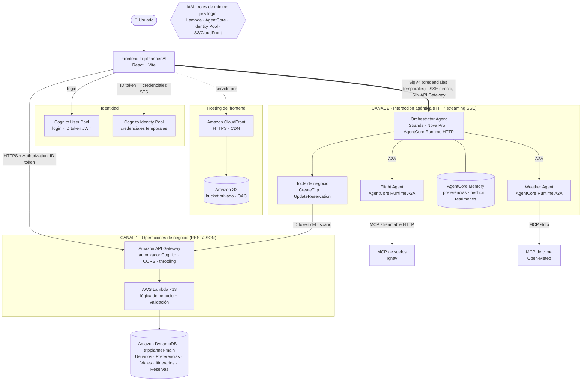

# TripPlanner AI — Documentación técnica

> Evolución de TripPlanner (3 agentes Strands sobre Amazon Bedrock AgentCore) a una
> plataforma web completa: frontend React, backend serverless y persistencia en DynamoDB.

**Contenido:** [1. Arquitectura](#1-arquitectura) · [2. Modelo de datos](#2-modelo-de-datos) ·
[3. APIs](#3-apis) · [4. Lambdas](#4-lambdas) · [5. Tools](#5-tools) ·
[6. Integración de agentes](#6-integración-de-agentes) · [7. Seguridad](#7-seguridad) ·
[8. Ejecución desde cero](#8-instrucciones-de-ejecución) · [9. Demo](#9-escenario-de-demostración) ·
[10. Opcionales](#10-funcionalidades-opcionales-implementadas)

---

## 1. Arquitectura

### 1.1 Diagrama (dos canales independientes)



> **API Gateway no está en el canal de streaming.** El navegador invoca
> `InvokeAgentRuntime` de AgentCore directamente, firmando con SigV4 mediante
> credenciales temporales de Cognito Identity Pool (rol limitado a invocar solo el Orchestrator).

### 1.2 Componentes y responsabilidades

| Componente | Responsabilidad | Implementación |
|---|---|---|
| Frontend | Experiencia de usuario, Agent-Driven UI | React 18 + Vite (`tripplanner-web/frontend`) |
| Amazon S3 + CloudFront | Publicación y distribución HTTPS del frontend | Bucket privado con Origin Access Control |
| Amazon Cognito | Registro, inicio de sesión y credenciales temporales | User Pool + Identity Pool |
| Amazon API Gateway | Expone las operaciones de negocio | REST API `tripplanner-api`, autorizador Cognito |
| AWS Lambda | Lógica de negocio y validaciones | 13 funciones Python 3.12 (`backend/lambdas`) |
| Amazon DynamoDB | Persistencia (fuente de verdad) | Tabla única `tripplanner-main` |
| Amazon Bedrock AgentCore | Ejecución de los agentes y memoria | 3 runtimes + 1 Memory |
| Strands Agents | Comportamiento agéntico y Tools | `app/*Agent/main.py` |
| MCP | Herramientas especializadas | Ignav (vuelos) y servidor MCP propio sobre Open-Meteo (clima) |
| IAM | Seguridad | Un rol por Lambda, rol del Identity Pool, roles de AgentCore |

### 1.3 Decisiones de diseño

| Decisión | Justificación |
|---|---|
| **Se conservan los 3 agentes** (Orchestrator, Flight, Weather) comunicados por A2A | Requisito no negociable. Cada especialista mantiene su MCP. |
| **Tools de negocio → API Gateway → Lambda** (en lugar de `lambda:Invoke` directo) | La Tool reenvía el **ID token del usuario**; el autorizador Cognito lo valida y la Lambda toma el `sub` del token. El agente no puede leer ni escribir datos de otro usuario aunque el modelo se equivoque o reciba una inyección de prompt. Se reutilizan las mismas Lambdas que usa el Canal 1. |
| **Eventos SSE tipados** (`status`, `text`, `ui`, `error`, `done`) | Permite indicadores de procesamiento y que el frontend pinte tarjetas a partir de datos estructurados (Agent-Driven UI), no de texto. |
| **Datos estructurados emitidos por las Tools**, no por el texto del LLM | Las tarjetas se construyen con la respuesta real de la Lambda/MCP, evitando que el modelo "invente" el contenido visual. Los especialistas añaden un bloque ```json``` que el Orchestrator extrae. |
| **MCP de clima propio (stdio) sobre Open-Meteo** | El Weather Agent original usaba datos fijos. Open-Meteo es gratuito y sin API key; para fechas > 16 días se devuelve una estimación histórica marcada como tal. |
| **Tabla única en DynamoDB** con todo bajo `PK = USER#<sub>` | Control de acceso estructural, una sola consulta para recuperar viaje + itinerario + reservas, menos costo y un único recurso que proteger. |
| **Identity Pool en vez de claves en el navegador** | Credenciales STS de 1 h, ligadas al usuario autenticado y limitadas a `InvokeAgentRuntime` del Orchestrator. |
| **AWS SAM** para el backend y el hosting | Infraestructura como código reproducible con `sam build && sam deploy`. |
| **Nova Pro** para el Orchestrator, Nova Lite para especialistas | El Orchestrator encadena hasta 12 Tools; Nova Pro es más fiable en tool-calling. Los especialistas hacen tareas simples. |

### 1.4 Memoria ≠ persistencia

| | AgentCore Memory | DynamoDB |
|---|---|---|
| Propósito | Conversar mejor | Fuente de verdad del negocio |
| Contenido | Historial de la sesión, preferencias inferidas (`USER_PREFERENCE`), hechos (`SEMANTIC`), resúmenes (`SUMMARIZATION`) | Usuarios, preferencias explícitas, viajes, itinerarios, reservas |
| Uso | Se inyecta como contexto en cada turno (`retrieval_config`) | Se lee/escribe solo mediante Lambdas |

---

## 2. Modelo de datos

**Tabla:** `tripplanner-main` · `PAY_PER_REQUEST` · cifrado SSE · Point-in-Time Recovery.
Claves: `PK` (HASH, S) y `SK` (RANGE, S). Sin índices secundarios: todos los patrones de acceso
se resuelven con `Query` sobre la partición del usuario.

| Entidad | PK | SK | Atributos principales |
|---|---|---|---|
| Usuario + Preferencias | `USER#<sub>` | `PROFILE` | `userId`, `name`, `preferences{budgetLevel, activityTypes[], dietaryRestrictions, preferredAirlines[], seatPreference, accommodationType, travelPace, homeCity, currency, notes}`, `createdAt`, `updatedAt` |
| Viaje | `USER#<sub>` | `TRIP#<tripId>` | `tripId`, `name`, `origin`, `destination`, `startDate`, `endDate`, `travelers`, `budget` (Number), `currency`, `preferences`, `status`, `createdAt`, `updatedAt` |
| Día de itinerario | `USER#<sub>` | `ITIN#<tripId>#<YYYY-MM-DD>` | `tripId`, `date`, `activities[{time, title, description, location, category, estimatedCost}]`, `notes` |
| Reserva | `USER#<sub>` | `RES#<tripId>#<reservationId>` | `reservationId`, `tripId`, `tripName`, `type`, `title`, `details`, `price`, `currency`, `date`, `status`, `provider`, `providerReference` |

`<sub>` es el identificador inmutable del usuario en Cognito, tomado **siempre** del token validado.

### Estados

| Entidad | Valores | Reglas |
|---|---|---|
| Viaje `status` | `PLANNING` → `CONFIRMED` → `COMPLETED` · `CANCELLED` | Se crea en `PLANNING`. |
| Reserva `status` | `SIMULADA` · `PENDIENTE` · `CONFIRMADA` | Se crea siempre `SIMULADA` (`provider = SIMULATED`). `SIMULADA ⇄ PENDIENTE` libre. `CONFIRMADA` exige `providerReference` de un proveedor real. |

### Patrones de acceso

| Patrón | Operación |
|---|---|
| Listar viajes del usuario | `Query PK = USER#sub, SK begins_with TRIP#` |
| Viaje por id | `GetItem PK = USER#sub, SK = TRIP#id` |
| Itinerario de un viaje (ordenado por fecha) | `Query PK = USER#sub, SK begins_with ITIN#id#` |
| Reservas de un viaje | `Query PK = USER#sub, SK begins_with RES#id#` |
| Todas las reservas del usuario | `Query PK = USER#sub, SK begins_with RES#` |
| Perfil y preferencias | `GetItem PK = USER#sub, SK = PROFILE` |

---

## 3. APIs

**Base:** salida `ApiUrl` del stack (`https://<id>.execute-api.us-east-2.amazonaws.com/prod`).
Todas las rutas requieren `Authorization: <ID token de Cognito>` (excepto `OPTIONS`).
Formato JSON. Fechas `YYYY-MM-DD`. Throttling: 20 req/s, ráfaga 40.

| Método | Ruta | Descripción | Body / parámetros | Respuesta |
|---|---|---|---|---|
| POST | `/trips` | Crear viaje | `origin*`, `destination*`, `startDate*`, `endDate*`, `travelers*` (1-20), `budget*` (>0), `currency`, `preferences`, `name` | `201 {tripId, trip}` |
| GET | `/trips` | Listar viajes | `?status=` opcional | `200 {trips[], count}` |
| GET | `/trips/{tripId}` | Viaje + itinerario + reservas | — | `200 {trip, itinerary[], reservations[]}` |
| PUT | `/trips/{tripId}` | Actualizar viaje | cualquier campo de creación + `status` | `200 {trip}` |
| POST | `/trips/{tripId}/itinerary` | Crear/reemplazar itinerario | `{days:[{date, activities[], notes}]}` o un día `{date, activities}` | `201 {itinerary[]}` |
| GET | `/trips/{tripId}/itinerary` | Consultar itinerario | — | `200 {itinerary[], count}` |
| PUT | `/trips/{tripId}/itinerary/{date}` | Modificar (o añadir) un día | `activities`, `notes` | `200 {day}` |
| POST | `/trips/{tripId}/reservations` | Registrar reserva | `type*` (FLIGHT/HOTEL/ACTIVITY), `details*`, `title`, `price`, `currency`, `date` | `201 {reservationId, status:"SIMULADA", reservation}` |
| GET | `/trips/{tripId}/reservations` | Reservas del viaje | `?status=` | `200 {reservations[], count}` |
| GET | `/reservations` | Todas las reservas del usuario | `?status=` | `200 {reservations[], count}` |
| PUT | `/trips/{tripId}/reservations/{reservationId}` | Actualizar reserva/estado | `status`, `providerReference`, `title`, `details`, `price`, `date`, `type` | `200 {reservation}` |
| GET | `/profile` | Perfil y preferencias | — | `200 {profile}` |
| PUT | `/profile` | Guardar preferencias | `name`, `preferences{…}` | `200 {profile}` |

### Errores

| Código | Cuándo | Ejemplo de cuerpo |
|---|---|---|
| 400 | Validación (tipos, rangos, fechas, estados, JSON inválido, datos de tarjeta) | `{"error": "endDate no puede ser anterior a startDate"}` |
| 401 | Sin token o token inválido/expirado (autorizador Cognito) | `{"error": "Unauthorized"}` |
| 404 | El recurso no existe **o pertenece a otro usuario** | `{"error": "Viaje no encontrado"}` |
| 429 | Throttling de API Gateway | `{"error": "Too Many Requests"}` |
| 500 | Error inesperado (se registra en CloudWatch; no se exponen detalles) | `{"error": "Error interno. Intenta de nuevo más tarde."}` |

---

## 4. Lambdas

Código en `tripplanner-web/backend/lambdas/`. Utilidades comunes en `common.py`
(identidad, validación, CORS, errores, acceso a datos). Runtime Python 3.12 · arm64.

| Función | Handler | Validaciones | Permisos IAM (solo sobre `tripplanner-main`) |
|---|---|---|---|
| `tripplanner-create-trip` | `trips.create_trip` | campos requeridos, fechas ISO y orden, duración ≤ 90 días, viajeros 1-20 enteros, presupuesto > 0, longitudes | `PutItem` |
| `tripplanner-get-trips` | `trips.get_trips` | — | `Query` |
| `tripplanner-get-trip` | `trips.get_trip` | existencia y pertenencia | `GetItem`, `Query` |
| `tripplanner-update-trip` | `trips.update_trip` | igual que creación + estado permitido + coherencia de fechas | `GetItem`, `UpdateItem` |
| `tripplanner-create-itinerary` | `itineraries.create_itinerary` | fechas dentro del viaje, sin duplicados, ≤ 15 actividades/día, tamaños | `GetItem`, `PutItem`, `BatchWriteItem` |
| `tripplanner-get-itinerary` | `itineraries.get_itinerary` | pertenencia del viaje | `GetItem`, `Query` |
| `tripplanner-update-itinerary` | `itineraries.update_itinerary` | fecha dentro del viaje, actividades válidas | `GetItem`, `UpdateItem` |
| `tripplanner-create-reservation` | `reservations.create_reservation` | tipo permitido, **rechazo de datos de tarjeta**, precio ≥ 0, estado inicial forzado `SIMULADA` | `GetItem`, `PutItem` |
| `tripplanner-get-reservations` | `reservations.get_reservations` | filtro de estado válido | `GetItem`, `Query` |
| `tripplanner-update-reservation` | `reservations.update_reservation` | transiciones de estado, `CONFIRMADA` requiere `providerReference`, rechazo de datos de tarjeta | `GetItem`, `UpdateItem` |
| `tripplanner-get-profile` | `profile.get_profile` | — | `GetItem` |
| `tripplanner-update-profile` | `profile.update_profile` | claves de preferencia permitidas, tamaños | `UpdateItem` |
| `tripplanner-cors` | `cors` | origen en lista permitida | ninguno |
| `tripplanner-pre-signup` | `pre_signup` (trigger Cognito) | auto-confirmación configurable (`AutoConfirmUsers`) | ninguno |

Pruebas: `tripplanner-web/backend/tests/test_lambdas.py` (23 casos con DynamoDB simulado por *moto*).

---

## 5. Tools

Definidas en `app/OrchestratorAgent/main.py` con `@tool` de Strands. Cada Tool de negocio
llama a su Lambda vía API Gateway con el token del usuario y emite un evento `ui`.

| Tool | Parámetros | Lambda que la respalda | Evento UI |
|---|---|---|---|
| **CreateTrip** `create_trip` | `origin, destination, start_date, end_date, travelers, budget, currency, preferences, name` | `tripplanner-create-trip` | `trip` |
| **GetTrips** `get_trips` | — | `tripplanner-get-trips` | `trips` |
| `get_trip_details` | `trip_id` | `tripplanner-get-trip` | `trip`, `itinerary`, `reservations` |
| **UpdateTrip** `update_trip` | `trip_id, changes{}` | `tripplanner-update-trip` | `trip` |
| **CreateItinerary** `create_itinerary` | `trip_id, days[{date, activities[], notes}]` | `tripplanner-create-itinerary` | `itinerary` |
| **UpdateItinerary** `update_itinerary` | `trip_id, day, activities[], notes` | `tripplanner-update-itinerary` | `itinerary` |
| **CreateReservation** `create_reservation` | `trip_id, reservation_type, title, details{}, price, reservation_date` | `tripplanner-create-reservation` | `reservations` |
| **GetReservations** `get_reservations` | `trip_id` (opcional) | `tripplanner-get-reservations` | `reservations` |
| **UpdateReservation** `update_reservation` | `trip_id, reservation_id, changes{}` | `tripplanner-update-reservation` | `reservations` |
| `save_preferences` | `preferences{}` | `tripplanner-get-profile` + `tripplanner-update-profile` | `preferences` |
| `ask_flights` | `request` | — (A2A → Flight Agent → MCP Ignav) | `flights` |
| `ask_weather` | `request` | — (A2A → Weather Agent → MCP clima) | `weather` |
| `get_traveler_profile` | — | `tripplanner-get-profile` + `tripplanner-get-trips` | — (contexto para personalizar) |
| `show_recommendations` | `kind, title, items[], destination` | — (datos generados por el agente) | `recommendations` |
| `show_food_recommendations` | `destination, items[], title` | — (datos generados por el agente) | `recommendations` (`kind = gastronomy`) |

Herramientas MCP de los especialistas:

| Agente | Servidor MCP | Herramientas |
|---|---|---|
| Flight Agent | `https://ignav.com/mcp` (streamable HTTP, API key en Secrets Manager) | `search_airports`, `search_flights` |
| Weather Agent | `app/WeatherAgent/weather_mcp_server.py` (stdio, Open-Meteo) | `geocode_city`, `get_forecast` |

---

## 6. Integración de agentes

### 6.1 Frontend → AgentCore (HTTP streaming)

1. El usuario inicia sesión en Cognito User Pool → **ID token**.
2. `GetId` + `GetCredentialsForIdentity` del Identity Pool → **credenciales STS temporales**.
3. `POST https://bedrock-agentcore.us-east-2.amazonaws.com/runtimes/<ARN>/invocations`
   firmado con SigV4 (`aws4fetch`), cabecera `X-Amzn-Bedrock-AgentCore-Runtime-Session-Id`
   (id de conversación estable) y cuerpo `{"prompt": "...", "idToken": "..."}`.
4. La respuesta es `text/event-stream`. El frontend (`src/lib/agent.js`) lee el `ReadableStream`
   y procesa cada evento:

| Evento | Uso en la UI |
|---|---|
| `{"type":"status","message":"✈️ Flight Agent consultando vuelos (MCP)…"}` | Lista de pasos con indicador animado |
| `{"type":"text","delta":"…"}` | Texto incremental con cursor |
| `{"type":"ui","component":"flights","data":{…}}` | Componente visual (ver tabla) |
| `{"type":"error","message":"…"}` / `{"type":"done"}` | Mensaje de error / fin |

| `component` | Componente React (`src/components/AgentCards.jsx`) |
|---|---|
| `flights` | `FlightCards`: tarjetas comparativas (aerolínea, horarios, duración, escalas, precio, “más barato”/“más rápido”) |
| `weather` | `WeatherCards`: tarjeta por día (máx/mín, condición, % lluvia, viento) |
| `trip` / `trips` | `TripCard` / `TripsList`: destino, fechas, noches, viajeros, presupuesto, estado |
| `itinerary` | `ItineraryAgenda`: agenda por día con horarios |
| `reservations` | `ReservationList`: listado con estado Simulada / Pendiente / Confirmada |
| `preferences` | `PreferencesCard` |
| `recommendations` | `RecommendationCards`: destinos, actividades o comida, con la línea **“Para ti”** que explica por qué encaja con el perfil |

### 6.2 Orchestrator → especialistas (A2A) → MCP

`ask_flights` / `ask_weather` envían un mensaje JSON-RPC `message/send` (A2A) firmado con SigV4
al runtime del especialista (permiso `invoke-specialists-policy.json`). Cada especialista usa
su cliente MCP de Strands (`MCPClient`) y responde con texto + un bloque ```json``` que el
Orchestrator convierte en evento `ui`.

### 6.3 Orchestrator → Tools de negocio → Lambda

```
Usuario: "Crea mi viaje"  →  Orchestrator decide create_trip  →  POST /trips (ID token)
→ API Gateway valida el token  →  Lambda valida y escribe en DynamoDB  →  {tripId, trip}
→ el agente redacta la respuesta y emite {"type":"ui","component":"trip"}  →  la UI pinta la tarjeta
```

### 6.4 Memoria

`AgentCoreMemorySessionManager` con `actor_id = sub` de Cognito (verificado vía `GET /profile`)
y `session_id` = id de conversación. Recupera `/preferences/{actorId}/` y `/facts/{actorId}/`
en cada turno. Además, las preferencias explícitas del perfil (DynamoDB) se inyectan en el prompt de sistema.

---

## 7. Seguridad

| Requisito | Implementación |
|---|---|
| IAM de mínimo privilegio | Un rol por Lambda con solo las acciones DynamoDB que usa, sobre una tabla. El rol del Identity Pool solo permite `bedrock-agentcore:InvokeAgentRuntime` sobre el Orchestrator. El bucket S3 solo acepta lecturas de la distribución CloudFront (OAC). |
| Sin credenciales en el frontend | El bundle solo contiene IDs públicos (pool, client, ARN, URL). Credenciales STS temporales vía Identity Pool. |
| Validación en Lambda | Tipos, rangos, fechas, estados, tamaños y claves permitidas (`common.py`). |
| Control de acceso por usuario | `userId` = `sub` del token validado por API Gateway; claves `PK = USER#sub`. Un usuario no puede acceder a datos ajenos (probado). |
| Protección de APIs | Autorizador Cognito, CORS restringido a CloudFront (+ `localhost:5173` en dev), throttling 20/40. |
| Manejo de errores | 400/401/404/429/500 con mensajes claros, sin trazas internas (registradas en CloudWatch). |
| Sin datos de tarjeta | Las Lambdas rechazan números de tarjeta (13-19 dígitos) y claves como `cardNumber`/`cvv`; el agente tiene la regla explícita de no pedirlos. |
| Contenido del modelo | El frontend escapa el HTML antes de renderizar Markdown (sin XSS); solo enlaces http/https. |

---

## 8. Instrucciones de ejecución

### Requisitos
AWS CLI v2 con credenciales (`us-east-2`), AWS SAM CLI, Node.js 18+, `agentcore` CLI, `uv`, Python 3.12.
Acceso a Amazon Nova Pro y Nova Lite en Bedrock.

### Despliegue completo (PowerShell, desde `tripplannera2a/`)

```powershell
.\deploy-all.ps1            # backend (SAM) → agentes (AgentCore) → frontend (S3 + CloudFront)
```

O por partes: `-Step backend`, `-Step agents`, `-Step frontend`. El script:
1. `sam validate --lint`, `sam build`, `sam deploy` (pasa el ARN del Orchestrator al rol del Identity Pool).
2. Sincroniza `TRIPPLANNER_API_URL` en `agentcore/agentcore.json` y ejecuta `agentcore deploy -y`.
3. Genera `.env.production` con las salidas del stack, compila React, sube a S3 e invalida CloudFront.

Al terminar imprime la **URL del frontend** (salida `FrontendUrl`).

### Desarrollo local del frontend
```powershell
cd tripplanner-web\frontend\tripplanner-frontend
npm install
npm run dev        # usa .env.development.local generado por deploy-all.ps1
```

### Pruebas
```powershell
cd tripplanner-web\backend
python -m venv .venv-test; .\.venv-test\Scripts\pip install "moto[dynamodb]>=5" boto3 pytest
.\.venv-test\Scripts\python -m pytest tests -q
```

### Prueba rápida de la API (con un ID token)
```bash
curl -H "Authorization: $ID_TOKEN" "$API_URL/trips"
```

---

## 9. Escenario de demostración

Prompt: *“Quiero organizar unas vacaciones de cuatro días en Cartagena. Salgo desde Bogotá, viajo
con dos personas más y tengo un presupuesto de 5 millones de pesos. Quiero conocer el clima,
encontrar vuelos y organizar algunas actividades turísticas”.*

| Paso | Qué ocurre | Dónde se ve |
|---|---|---|
| 1 | Registro / inicio de sesión | Pantalla de login (Cognito) |
| 2 | Se envía el prompt (es la primera sugerencia del chat) | Chat, streaming |
| 3 | Orchestrator interpreta (3 viajeros, 5.000.000 COP, propone fechas) | Paso “🧭 Orchestrator interpretando…” |
| 4 | Flight Agent consulta vuelos vía MCP Ignav | Paso “✈️ Flight Agent…” |
| 5 | Weather Agent consulta el clima vía MCP Open-Meteo | Paso “🌤️ Weather Agent…” |
| 6 | Tarjetas de vuelos y de clima | Chat (Agent-Driven UI) |
| 7 | Usuario: *“Crea el viaje con esas fechas y arma el itinerario”* | Chat |
| 8 | `create_trip` + `create_itinerary` | Tarjeta de viaje + agenda por día |
| 9 | Usuario: *“Reserva el vuelo más barato”* → `create_reservation` | Listado con estado **Simulada** |
| 10 | Datos en DynamoDB | Consola DynamoDB → `tripplanner-main` |
| 11 | Cerrar sesión | Botón “Cerrar sesión” |
| 12 | Volver a entrar | Dashboard (próximos viajes, reservas), Mis viajes → detalle, o chat *“Muéstrame mis viajes”* |

---

## 10. Funcionalidades opcionales implementadas

| Funcionalidad | Cómo funciona | Dónde verlo |
|---|---|---|
| 📄 **Exportación PDF** | Se genera en el navegador con jsPDF (carga diferida, ~130 KB gzip solo al exportar). Incluye resumen del viaje, presupuesto (reservado / estimado / disponible), itinerario día por día y reservas con su estado. No se envía a ningún servicio externo. | **Mis viajes → detalle → “📄 Descargar PDF”** |
| ⭐ **Recomendaciones personalizadas** | `get_traveler_profile` lee las preferencias y el historial de viajes (DynamoDB vía Lambda); el agente elige 3-6 opciones y las envía con `show_recommendations`. Cada tarjeta incluye **“Para ti”**, que cita la preferencia o el historial que justifica la recomendación. Complementa la memoria de AgentCore. | Chat: *“Recomiéndame destinos para mi próximo viaje según mis preferencias”* |
| 🍽️ **Recomendaciones gastronómicas** | `show_food_recommendations`: platos típicos + tipo de lugar o zona, nivel de precio ($-$$$$), momento del día y etiquetas dietéticas. **Respeta las restricciones alimentarias** del perfil (p. ej. vegetariano) y ajusta el precio al presupuesto. | Chat: *“¿Qué comida típica me recomiendas en Cartagena?”* o **Mis viajes → detalle → “🍽️ Dónde comer”** |

**Prueba sugerida en la sustentación:**
1. *“Me encantan la playa y la naturaleza, presupuesto moderado, ritmo relajado, salgo desde Bogotá. Guarda estas preferencias.”* → tarjeta ⭐ Preferencias guardadas.
2. *“Recomiéndame destinos para mi próximo viaje según mis preferencias”* → tarjetas de destinos con “Para ti”.
3. *“Soy vegetariano, guárdalo”* y luego **“🍽️ Dónde comer”** en el viaje a Cartagena → solo opciones vegetarianas.
4. En el viaje, **“📄 Descargar PDF”** → documento con itinerario, presupuesto y reservas.
